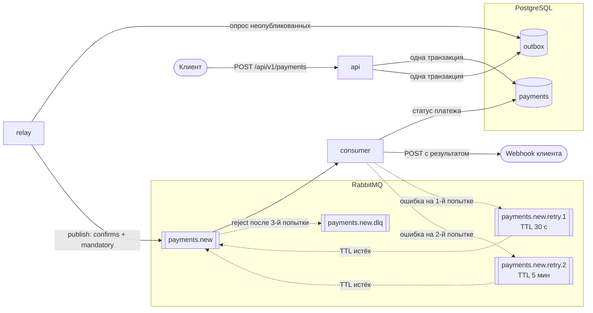

# Асинхронный сервис процессинга платежей

> TLDR: run with `make up`

Сервис принимает запросы на оплату, обрабатывает их через эмулятор платёжного шлюза и уведомляет клиента о результате через webhook.

ТЗ в файле `Тестовое PYTHON.md`

## Архитектура



Сплошные стрелки — основной путь платежа, пунктирные — повторные попытки и DLQ.

1. `api` в одной транзакции сохраняет платёж в `payments` и событие в `outbox` и сразу отвечает `202 Accepted`.
2. `relay` забирает неопубликованные события из `outbox` и публикует их в очередь `payments.new`. Также периодически очищает старые события из `outbox`
3. `consumer` эмулирует обработку (2–5 секунд, 90% успех), сохраняет статус и отправляет webhook.
4. При ошибке сообщение уходит в очередь задержки и возвращается через 30 секунд, затем через 5 минут. После 3 неудачных попыток оно попадает в `payments.new.dlq`.

| Каталог | Назначение |
|---|---|
| `api` | FastAPI: создание и получение платежей |
| `relay` | Публикация событий из outbox в RabbitMQ (outbox pattern) и очистка старых событий |
| `consumer` | Обработка платежей, отправка webhook, повторные попытки |
| `data` | Общий пакет: модели SQLAlchemy, репозитории, DTO |
| `migrations` | Миграции Alembic, отдельный одноразовый контейнер |
| `rabbitmq` | Конфигурация брокера и топология очередей (`definitions.json`) |
| `loadtest` | Скрипт нагрузочного тестирования и тестовый получатель webhook |
| `postgres` | Переменные окружения PostgreSQL |

## Запуск

Требования: Docker с Compose v2.24+, [uv](https://docs.astral.sh/uv/), `make`.

```sh
make up      # собрать образы и запустить всё; ждёт, пока сервисы станут healthy
make down    # остановить и удалить контейнеры (данные в volumes сохраняются)
```

После запуска:

- Документация API (Swagger): http://localhost:8000/docs (API ключ `example-api-key`)
- Интерфейс RabbitMQ: http://localhost:15672 (логин и пароль `guest` / `guest`)

### Конфигурация

Каждый сервис читает переменные из `<сервис>/.env.example`, поэтому проект запускается сразу после `git clone` без дополнительной настройки. Чтобы переопределить значения, создайте рядом `<сервис>/.env`: он необязателен, игнорируется git и имеет приоритет над примером.

| Сервис | Переменные |
|---|---|
| `api` | `DATABASE_URL`, `API_KEY` |
| `relay` | `DATABASE_URL`, `RABBITMQ_URL`, `RELAY_BATCH_SIZE` (100), `RELAY_POLL_INTERVAL` (1.0 с), `RELAY_MAX_BACKOFF` (30 с), `RELAY_CLEANUP_INTERVAL` (3600 с), `RELAY_OUTBOX_RETENTION` (`P7D`) |
| `consumer` | `DATABASE_URL`, `RABBITMQ_URL`, `CONSUMER_PREFETCH_COUNT` (10), `CONSUMER_MAX_ATTEMPTS` (3), `CONSUMER_WEBHOOK_TIMEOUT` (10 с), `GATEWAY_SUCCESS_RATE` (0.9), `GATEWAY_MIN_SECONDS` (2), `GATEWAY_MAX_SECONDS` (5) |
| `migrations` | `DATABASE_URL` |
| `rabbitmq` | `RABBITMQ_DEFAULT_USER`, `RABBITMQ_DEFAULT_PASS` |
| `postgres` | `POSTGRES_USER`, `POSTGRES_PASSWORD`, `POSTGRES_DB` |

Настройки валидируются при старте: при некорректном значении сервис не запустится и перечислит все ошибки.

Длительности вроде `RELAY_OUTBOX_RETENTION` задаются в формате ISO 8601: `P7D` — 7 дней, `PT12H` — 12 часов.

## Примеры API

Все эндпоинты платежей требуют заголовок `X-API-Key` (значение `API_KEY` из `api/.env.example`).

### Создание платежа

```sh
curl -X POST http://localhost:8000/api/v1/payments \
  -H "X-API-Key: example-api-key" \
  -H "Idempotency-Key: order-1042" \
  -H "Content-Type: application/json" \
  -d '{
        "amount": "1500.00",
        "currency": "RUB",
        "description": "Order #1042",
        "metadata": {"order_id": 1042},
        "webhook_url": "https://merchant.example.com/webhooks/payments"
      }'
```

Ответ `202 Accepted`:

```json
{
  "payment_id": "01a164ab-14b4-7659-a446-ffcb87eb11d1",
  "status": "pending",
  "created_at": "2026-10-22T17:31:35.989404Z"
}
```

- Повтор запроса с тем же `Idempotency-Key` и тем же телом вернёт тот же платёж (`202`) без создания нового.
- Тот же `Idempotency-Key` с другим телом вернёт `409 Conflict`.
- Без `Idempotency-Key` или с некорректным телом вернётся `422`, без `X-API-Key` или с неверным ключом — `401`.

### Получение платежа

```sh
curl http://localhost:8000/api/v1/payments/01a164ab-14b4-7659-a446-ffcb87eb11d1 \
  -H "X-API-Key: example-api-key"
```

Ответ `200 OK`:

```json
{
  "payment_id": "01a164ab-14b4-7659-a446-ffcb87eb11d1",
  "amount": "1500.00",
  "currency": "RUB",
  "description": "Order #1042",
  "metadata": {"order_id": 1042},
  "status": "succeeded",
  "idempotency_key": "order-1042",
  "webhook_url": "https://merchant.example.com/webhooks/payments",
  "created_at": "2026-10-22T17:31:35.989404Z",
  "processed_at": "2026-10-22T17:31:39.512301Z"
}
```

- Несуществующий платёж вернёт `404`.
- Неверный `X-API-Key` или его отсутствие — `401`.

### Проверка состояния

`GET /health` не требует API-ключа и проверяет доступность базы данных: `200 {"status": "ok", "database": "ok"}` или `503`, если база недоступна. На нём основан healthcheck контейнера `api`.

### Webhook

После обработки `consumer` отправляет `POST` на `webhook_url`:

```json
{
  "payment_id": "01a164ab-14b4-7659-a446-ffcb87eb11d1",
  "status": "succeeded",
  "amount": "1500.00",
  "currency": "RUB",
  "processed_at": "2026-10-22T17:31:39.512301Z"
}
```

Любой ответ кроме `2xx` считается ошибкой и приводит к повторной попытке. Доставка гарантируется по принципу at-least-once, поэтому получатель должен устранять дубли по `payment_id`.

## Гарантии доставки

- **Outbox pattern.** Платёж и событие сохраняются в одной транзакции. `relay` публикует события с publisher confirms и `mandatory`, поэтому сообщение, для которого нет очереди, не теряется, а остаётся в outbox до следующей попытки.
- **Идемпотентность API.** Уникальный индекс по `idempotency_key` и `INSERT … ON CONFLICT DO NOTHING` защищают от дублей даже при одновременных запросах.
- **Идемпотентность consumer.** Результат списания фиксируется до отправки webhook. Повторная попытка видит, что платёж уже не `pending`, и только переотправляет webhook, не проводя списание заново. Статус меняется через `UPDATE … WHERE status = 'pending'`, поэтому две доставки одного сообщения не могут обе записать результат.
- **Повторные попытки и DLQ.** 3 попытки с экспоненциальной задержкой через очереди задержки, после чего сообщение уходит в `payments.new.dlq`.

### Очистка outbox

Опубликованные события не удаляются сразу: по `published_at` можно проверить, было ли событие отправлено и когда. `relay` раз в `RELAY_CLEANUP_INTERVAL` (и сразу при старте) удаляет события, опубликованные раньше, чем `RELAY_OUTBOX_RETENTION` назад. Удаление идёт пачками по 1000 строк, чтобы не держать долгие блокировки и не создавать всплесков записи в журнал PostgreSQL. Для запроса есть частичный индекс `ix_outbox_published` по `published_at`. Неопубликованные события очистка не трогает. Ошибка очистки логируется и не мешает публикации.

## Очереди RabbitMQ

Топология описана в `rabbitmq/definitions.json` и применяется одноразовым контейнером `rabbitmq-definitions`, аналогично миграциям базы данных. Сервисы очереди не создают: `consumer` при старте только проверяет их наличие и не запустится, если топология не применена.

| Очередь | Политика | Назначение |
|---|---|---|
| `payments.new` | dead-letter в `payments.new.dlq` | Основная очередь событий о новых платежах |
| `payments.new.retry.1` | TTL 30 с, затем обратно в `payments.new` | Задержка перед 2-й попыткой |
| `payments.new.retry.2` | TTL 5 мин, затем обратно в `payments.new` | Задержка перед 3-й попыткой |
| `payments.new.dlq` | — | Сообщения, не обработанные за 3 попытки |

Задержки гибкие: они заданы политиками в `definitions.json`, а не в коде. Чтобы изменить задержку, поправьте `message-ttl` и выполните `make up` (или `docker compose up rabbitmq-definitions`): политики обновятся на месте, без пересоздания очередей. Чтобы изменить число попыток, поменяйте `CONSUMER_MAX_ATTEMPTS` и добавьте или удалите очереди `payments.new.retry.N` с их политиками. Импорт ничего не удаляет, поэтому лишние очереди и политики нужно удалить вручную в интерфейсе RabbitMQ.

## Разработка

```sh
make install       # установить зависимости всех пакетов
make format        # отформатировать код и исправить замечания ruff
make lint          # проверить форматирование и линтер
make test          # запустить тесты всех пакетов
make test-api      # тесты одного пакета: test-api, test-consumer, test-data, test-migrations, test-relay
make check         # lint + test
```

Для тестов нужен запущенный Docker: тесты с базой данных поднимают PostgreSQL через testcontainers. Тесты `migrations` применяют настоящие миграции Alembic и проверяют, что схема совпадает с моделями. Тест топологии в `consumer` сверяет код с `rabbitmq/definitions.json`.

`make check` стоит добавить в CI workflow, чтобы линтер и тесты запускались на каждый pull request.

## Нагрузочное тестирование

Скрипт `loadtest/load_test.py` параллельно создаёт платежи через API, выводит пропускную способность и задержки, а затем каждые 5 секунд показывает глубину очередей RabbitMQ, пока `consumer` разбирает накопившиеся сообщения.

```sh
make up
make load                                        # 300 платежей, 20 параллельных запросов
make load ARGS="--total 1000 --concurrency 50"   # свои параметры
```

`make load` сначала поднимает `webhook-sink` — тестовый получатель webhook (профиль `loadtest` в Compose, при обычном `make up` не запускается). Он отвечает `200`, но в 10% случаев возвращает `500` (`WEBHOOK_FAILURE_RATE`), поэтому часть сообщений уходит на повторные попытки. Доля `--fail-share` платежей (по умолчанию 5%) получает адрес `/fail`, который всегда отвечает `500`: такие сообщения после 3 попыток попадают в DLQ.

Пример вывода:

```
Sent 300 payments in 2.2s (135 req/s)
Responses: 202: 300
Latency: p50 115 ms, p95 271 ms, max 398 ms
Queue depths for the next 60s (Ctrl+C to stop):
waiting=124  processing=10  retry.1=12  retry.2=0  dlq=0
waiting=109  processing=10  retry.1=11  retry.2=0  dlq=0
```

- `waiting` — сообщения в `payments.new`, ожидающие обработки; `processing` — взятые `consumer`, но ещё не подтверждённые (не больше `CONSUMER_PREFETCH_COUNT`).
- `consumer` обрабатывает около 3 платежей в секунду (10 параллельно по 2–5 секунд), поэтому очередь заметно растёт и затем разбирается.
- Сообщения в `retry.2` и DLQ появляются не сразу: задержки между попытками — 30 секунд и 5 минут.

Остальные параметры: `python loadtest/load_test.py --help`. Пока идёт нагрузка, удобно смотреть графики в интерфейсе RabbitMQ (http://localhost:15672) и статусы платежей в базе:

```sh
docker compose exec postgres psql -U payments -c "SELECT status, count(*) FROM payments GROUP BY status"
```

## Принятые решения

- В `consumer` неудачный charge считается успешной обработкой, которую не нужно повторять. Это бизнес-результат (платёж отклонён), а не техническая ошибка: клиент получает webhook со статусом `failed`. Повторяются только технические ошибки, например недоступный webhook или база данных.
- Повторные попытки реализованы через очереди задержки в RabbitMQ, а не через `sleep` в обработчике: ожидание не занимает consumer и переживает его перезапуск.
- `api` не работает с брокером напрямую: все события проходят через outbox.
- Топология RabbitMQ хранится в `definitions.json` и применяется отдельным контейнером, TTL и dead-lettering задаются политиками.
- Платёжный шлюз должен быть идемпотентным по `payment.id`. `consumer` проверяет статус `pending` до charge, а результат сохраняет после него, поэтому charge может выполниться повторно для одного платежа: если база данных недоступна после успешного charge и сообщение уходит на повторную попытку, если `relay` доставил событие дважды или если `consumer` остановлен посреди обработки. Эмулированный шлюз от этого не страдает, а настоящему нужно передавать `payment.id` как ключ идемпотентности

## TODO на будущее

- Обработка DLQ
- Валидировать вебхуки и исключать внутренние адреса, чтобы избежать SSRF
- Завести в PostgreSQL отдельные роли. Сейчас `api`, `relay`, `consumer` и `migrations` подключаются под `POSTGRES_USER`, который является суперпользователем. Миграциям нужна роль-владелец схемы, а сервисам достаточно роли с правами только на чтение и запись данных (`SELECT`, `INSERT`, `UPDATE`, `DELETE`)
- Ограничить размер `description` и `metadata` в `POST /api/v1/payments` и запретить пустой `description`. Сейчас их длина не ограничена, и клиент может сохранить в базе произвольно большие данные, которые затем проходят через `relay` и `consumer`
- Не выбирать в `relay` события outbox, которые невозможно опубликовать. Сейчас событие с неизвестным `event_type` (например, после деплоя `api` с новым типом раньше `relay` или после переименования константы) остаётся неопубликованным и выбирается в каждую пачку. Если таких событий накопится не меньше `RELAY_BATCH_SIZE`, они займут всю пачку и `relay` перестанет публиковать остальные события. Решение — статус ошибки или счётчик попыток у строки outbox (нужна миграция). Это же покрыло бы строки с `payload`, который не является JSON-объектом, и сообщения больше `max_message_size` в RabbitMQ
- Добавить генерацию документации для `consumer`
- Подписывать webhook (HMAC тела запроса общим секретом в заголовке), чтобы получатель мог проверить, что уведомление отправил именно этот сервис
- Добавить healthcheck для `relay` и `consumer`: сейчас Compose считает их здоровыми, пока процесс запущен, даже если он завис или потерял соединение с базой данных или брокером
- Перевести `payments.new` на quorum queue с политикой `delivery-limit`. Сейчас попытки считает заголовок `x-attempt`, который увеличивается только при пойманном исключении. Если consumer падает во время обработки (OOM, kill), RabbitMQ возвращает сообщение с тем же заголовком, и такое сообщение может бесконечно ронять consumer. Quorum queue сама считает доставки и после лимита отправляет сообщение в DLQ. Отложено из-за минусов: на одном узле это лишняя нагрузка на диск без выигрыша в отказоустойчивости, dead-lettering по умолчанию at-most-once (для at-least-once нужны `dead-letter-strategy: at-least-once` и `overflow: reject-publish`), а тип очереди нельзя поменять на месте: `payments.new` придётся удалить и создать заново
- Подключить сервис сбора ошибок. Сейчас трейсбеки (например, неудачные отправки webhook в `consumer`) пишутся только в stdout контейнера и теряются при его пересоздании. Сервис сбора ошибок сохраняет исключения со стеком и контекстом, группирует одинаковые ошибки и уведомляет о новых. Варианты: [Sentry](https://sentry.io) (есть self-hosted версия и интеграции с FastAPI и asyncio), [GlitchTip](https://glitchtip.com) (open source, совместим с SDK Sentry), [Rollbar](https://rollbar.com), [Bugsnag](https://www.bugsnag.com). Как дополнение — централизованный сбор логов: Grafana Loki, ELK (Elasticsearch, Logstash, Kibana) или OpenTelemetry с любым совместимым бэкендом
